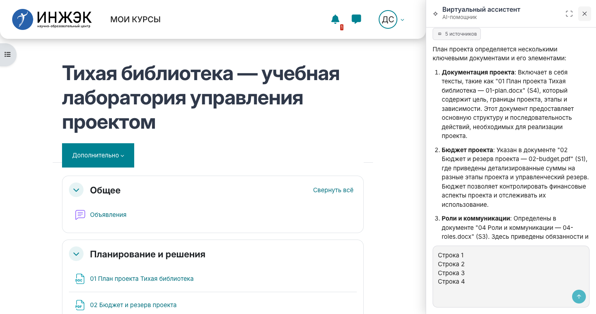
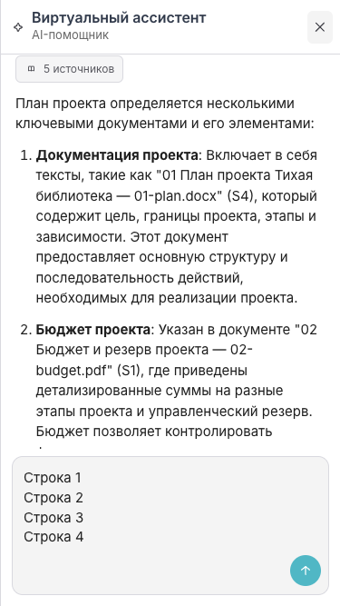
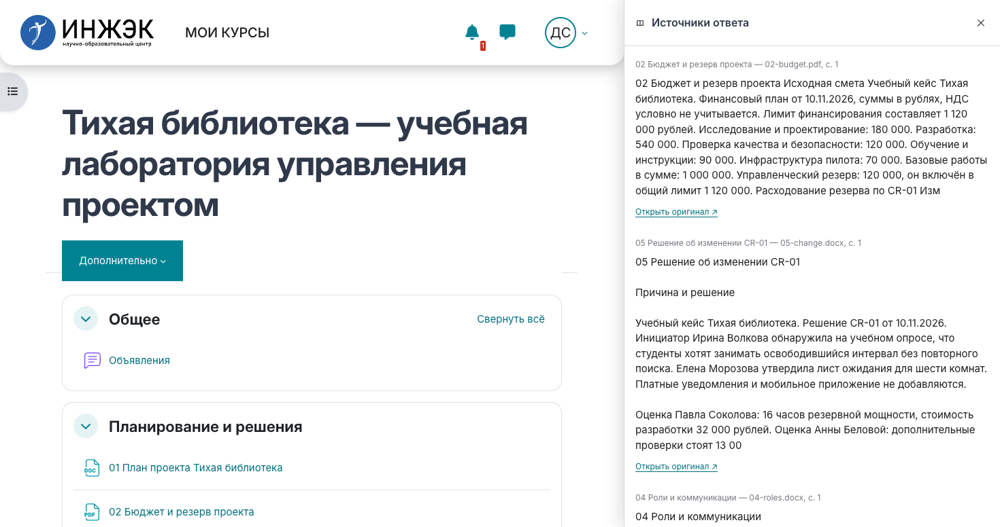

# Moodle RAG plugin

Три стандартных компонента Moodle 4.5 LTS: `local_rag` — серверная интеграция и контроль доступа, `block_ragchat` — чат, `theme_inzhe` — оформление Moodle на основе Boost. Backend RAG и его административное приложение развёртываются отдельно и в этот репозиторий не входят: [rag-service](https://github.com/like-Ocean/rag-service), [rag-admin](https://github.com/tarkue/rag-admin).

## Возможности чата

- На desktop чат закреплён справа и освобождает место в странице; его можно отсоединить перетаскиванием, вернуть к краю или развернуть. На телефоне — один экран на всю ширину, только X для закрытия.
- Ответы поддерживают ограниченный Markdown: заголовки, выделение, списки, таблицы, цитаты, ссылки HTTP(S), inline/fenced code. Это собственный DOM renderer без CDN; HTML отображается текстом, Markdown-изображения не загружаются. Полная совместимость CommonMark/GFM не заявляется.
- Есть копирование ответа и блока кода, переход к последним сообщениям и отдельная панель разрешённых источников с переходом к оригиналам Moodle.
- Launcher пульсирует; анимации учитывают `prefers-reduced-motion`. Поле ввода растёт до четырёх строк, кнопка отправки находится в отдельной строке под полем справа и не перекрывает текст; ошибки длины показываются после попытки отправки, а не при наборе.

## Установка в существующий Moodle

Нужны установленный Moodle 4.5, совместимый PHP с cURL, DOM/libxml и ZipArchive (native HTML преобразуется во временный DOCX), стандартная БД Moodle, рабочий cron и доступ PHP-сервера к RAG API. Изолированная установка проверена на Moodle 4.5.15, PHP 8.2.35 и PostgreSQL 16.14: upgrade, INZHE/Boost, отключённый режим, доступ пользователей и native Page → DOCX → изолированный mock API. Эта проверка подтверждает установку и wiring; реальный backend развёртывается и проверяется отдельно. Сначала сделайте резервную копию существующего Moodle.

Скопируйте `local/rag`, `blocks/ragchat`, `theme/inzhe` в одноимённые каталоги Moodle. Запускайте CLI от владельца файлов Moodle:

```sh
php /path/to/moodle/admin/cli/upgrade.php --non-interactive
php /path/to/moodle/admin/cli/cfg.php --name=theme --set=inzhe
php /path/to/moodle/admin/cli/purge_caches.php
```

Или для первой установки всех трёх компонентов из standalone поставки:

```sh
sh scripts/install.sh /path/to/moodle
```

Повторный запуск с идентичным кодом допустим; installer откажется перезаписывать существующие компоненты с отличиями. При обновлении сначала сравните/замените их код и выполните стандартный upgrade. Скрипт не пишет `config.php` и не использует прямой SQL. Сам Moodle устанавливается штатным web installer или `admin/cli/install.php`.

Тему можно выбрать через Администрирование → Внешний вид → Темы → Выбор темы → INZHE Knowledge. Один `local_rag` не меняет весь интерфейс Moodle: общий дизайн появляется после установки и выбора `theme_inzhe`. Серверная интеграция и генерация chat markup проверены также с Boost; визуальная QA выполнена для INZHE. Сторонние темы требуют своей проверки вёрстки. Карточки каталога используют штатную Database activity и шаблоны из `theme/inzhe/dbtemplates/`; тема не создаёт курс и не импортирует пользовательские документы.

Для каталога создайте в курсе стандартную activity «База данных» (Database), затем поля `Название` (text), `Автор` (text), `Год` (number), `Теги` (text), `Файл` (file), `Обложка` (picture). В Templates → List template вставьте содержимое `listheader.html` в Header, `listtemplate.html` в Repeated entry, `listfooter.html` в Footer из `theme/inzhe/dbtemplates/`; `asearchtemplate.html` вставьте в Advanced search template. Сохраните шаблоны и добавьте свои разрешённые записи/файлы. Это отдельная настройка native activity через Moodle UI, она не выполняется installer скриптом.

## URL, ключи и cron

Для чата и ingestion передайте **серверному PHP-процессу и cron** `RAG_SERVICE_URL` и `RAG_SERVICE_TOKEN`. Третья переменная `RAG_ADMIN_TOKEN` необязательна и нужна только для управления backend:

```text
RAG_SERVICE_URL=https://rag.example.org
RAG_SERVICE_TOKEN=<service credential>
RAG_ADMIN_TOKEN=<administration credential>
```

См. `.env.example` / `examples/environment.env.example`. Это образцы, не готовые секреты. Значения берутся из `local/rag/classes/configuration.php`: env имеет приоритет над серверными настройками Moodle, явно пустой токен отключает интеграцию. URL допускает HTTP/HTTPS без credentials, query и fragment. Backend должен предоставлять `/api` endpoints; URL может включать завершающий `/api`.

Ключи остаются только на сервере: не вставляйте их в HTML, JavaScript, Git, командную строку или публичный webroot. Для Docker используйте закрытый `env_file`/секреты вашего deployment; файл `.env` сам по себе не передаёт переменные контейнеру. Для FPM проверьте pool `clear_env` и явную передачу env (пример `examples/php-fpm.conf.example`), для Apache — окружение его service/container. Перезапустите PHP workers после изменения. Проверка `getenv()` только в CLI не доказывает, что env виден FPM/Apache. Cron должен получать те же значения.

Без `RAG_SERVICE_TOKEN` чат и его assets не выводятся, proxy закрыт, ingestion пропускается; администратору показывается предупреждение. Для admin page дополнительно требуются `local/rag:manage` и `RAG_ADMIN_TOKEN`.

Настройте ежеминутный cron штатным способом:

```cron
* * * * * /usr/bin/php /path/to/moodle/admin/cli/cron.php >/dev/null 2>&1
```

Для первой сверки после установки:

```sh
php /path/to/moodle/admin/cli/scheduled_task.php --execute='\local_rag\task\reconcile_documents'
php /path/to/moodle/admin/cli/cron.php
```

Доступ к чату требует входа, доступа к текущему курсу и `local/rag:use`; скрытые/недоступные материалы отфильтровываются сервером. Проверяйте под зачисленным и посторонним пользователем. Перечень поддерживаемых источников смотрите в `local/rag/README.md` текущей версии. Синхронизация передаёт данные настроенному backend, поэтому проверьте его политику хранения.

## Сборка и проверка

Готовые AMD modules включены; npm install не нужен. После изменения JS:

```sh
node blocks/ragchat/build.cjs
node theme/inzhe/build.cjs
node --test blocks/ragchat/tests/chat_test.cjs
```

Real-DOM тесты Markdown используют **только dev dependency** LinkeDOM 0.18.12 (ISC); для установки Moodle и production frontend он не нужен. Запуск без глобальной установки и без записи node_modules в исходники:

```sh
rag_dom_dependencies=$(mktemp -d)
npm install --prefix "$rag_dom_dependencies" --no-audit --no-fund --ignore-scripts linkedom@0.18.12
NODE_PATH="$rag_dom_dependencies/node_modules" node --test blocks/ragchat/tests/markdown_test.cjs
rm -rf "$rag_dom_dependencies"
```

PHP tests требуют отдельного настроенного PHPUnit окружения Moodle: `vendor/bin/phpunit --testsuite local_rag_testsuite`. Не запускайте Moodle PHPUnit на пользовательской БД. Сторонние зависимости и подтверждённые уведомления о лицензиях: [THIRD_PARTY.md](THIRD_PARTY.md). Отдельной общей LICENSE в исходном наборе нет; сохранены имеющиеся уведомления Moodle GPL и Inter OFL.

## Скриншоты

Учебный демонстрационный курс; документы и данные курса в поставку не включены.

Пример интерфейса с сохранённым реальным ответом тестового курса (скриншоты воспроизведения). Черновик из четырёх строк показывает полную ширину поля и отдельную нижнюю строку отправки:




Панель источников из отдельной реальной сетевой проверки, с переходом к оригиналам Moodle:


